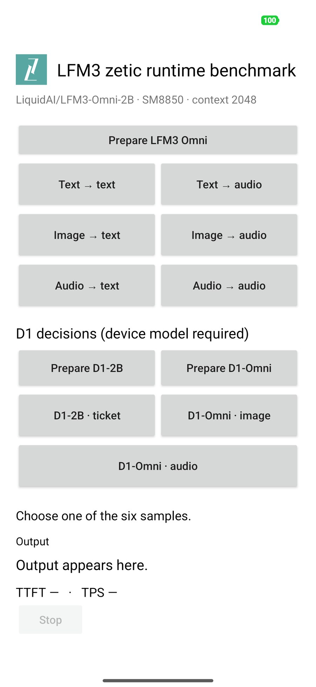

# Android: install and run the demo

Follow steps 1–6 in order. Run terminal commands on your computer, in the same Bash session. The default phone is **Galaxy S26 Ultra (`v81`)**.

## 1. Prepare your computer and phone

Install these tools before continuing:

| Tool | Required setup |
| --- | --- |
| Android SDK | Platform 35, Platform Tools (`adb`), NDK `27.0.12077973`; set `ANDROID_HOME` to the SDK directory or configure `android/local.properties` |
| Java | JDK 17 |
| Git | Available in your terminal |
| Hugging Face CLI | `hf` available; [installation instructions](https://huggingface.co/docs/huggingface_hub/en/guides/cli) |

Get the project:

```sh
git clone https://github.com/zetic-ai/LFM3-zetic-apps.git
cd LFM3-zetic-apps
```

Already cloned it? Open a terminal at the repository root instead.

Enable **USB debugging** on the phone, connect it by USB, and accept its debugging prompt. Check the connection:

```sh
adb devices
```

**Check:** your phone appears with status `device`. Set its serial for the remaining commands:

```sh
DEVICE_SERIAL=YOUR_DEVICE_SERIAL
```

Replace `YOUR_DEVICE_SERIAL` with the serial printed by `adb devices`.

## 2. Build and install the app

```sh
(cd android && ./gradlew assembleDebug)
adb -s "$DEVICE_SERIAL" install -r android/app/build/outputs/apk/debug/app-debug.apk
adb -s "$DEVICE_SERIAL" shell am start -n ai.zetic.lfm3demo/.MainActivity
```

**Check:** the build prints `BUILD SUCCESSFUL`, installation prints `Success`, and **LFM3 zetic runtime benchmark** opens. A model-not-found message is expected until step 4.

## 3. Download the three demo models

1. Open [ZETIC-ai/LFM3](https://huggingface.co/ZETIC-ai/LFM3).
2. Request access and wait for approval, if you do not already have access.
3. Log in with that approved Hugging Face account:

```sh
hf auth login
```

Choose your phone target:

| Phone | Set `TARGET` to |
| --- | --- |
| **Galaxy S26 Ultra (default)** | **`v81`** |
| Xiaomi / SM8850 | `v81` |
| Galaxy S25 / SM8750 | `v79` |

```sh
TARGET=v81
hf download ZETIC-ai/LFM3 --local-dir models-android --include "qualcomm/lfm3-omni-2b/$TARGET/*"
hf download ZETIC-ai/LFM3 --local-dir models-android --include "qualcomm/d1-2b/$TARGET/*"
hf download ZETIC-ai/LFM3 --local-dir models-android --include "qualcomm/d1-omni-2b/$TARGET/*"
ls models-android/qualcomm/*/"$TARGET"/manifest.json
```

**Check:** `ls` lists a manifest for each of these three packages:

| Package | Used for |
| --- | --- |
| `lfm3-omni-2b` | All six text/image/audio generation samples, including text → text |
| `d1-2b` | D1 ticket decisions |
| `d1-omni-2b` | D1 image and audio decisions |

Keep each complete package, including its manifest and payload files.

## 4. Copy the models to the phone

Close the app while copying, then transfer the downloaded `qualcomm` directory:

```sh
adb -s "$DEVICE_SERIAL" shell am force-stop ai.zetic.lfm3demo
adb -s "$DEVICE_SERIAL" shell mkdir -p /sdcard/Android/data/ai.zetic.lfm3demo/files/models
adb -s "$DEVICE_SERIAL" push models-android/qualcomm /sdcard/Android/data/ai.zetic.lfm3demo/files/models/
adb -s "$DEVICE_SERIAL" shell chmod -R a+rX /sdcard/Android/data/ai.zetic.lfm3demo/files/models/qualcomm
```

**Check:** for the default `v81` target, the phone must contain:

```text
/sdcard/Android/data/ai.zetic.lfm3demo/files/models/
└── qualcomm/
    ├── lfm3-omni-2b/v81/manifest.json
    ├── d1-2b/v81/manifest.json
    └── d1-omni-2b/v81/manifest.json
```

Use `v79` in these paths if you selected Galaxy S25.

## 5. Run the first example

```sh
adb -s "$DEVICE_SERIAL" shell am start -n ai.zetic.lfm3demo/.MainActivity
```

1. Wait for **LFM3 Omni** to finish loading.
2. Tap **Text → text**.
3. Wait for the run to finish, then scroll down to **Output**.

**Check:** a summary of Darwin's introduction appears, followed by **TTFT** and **TPS**. You have completed the first run.

After installation and model setup, the loaded app looks like this on Xiaomi / SM8850 (`v81`). The default download example above remains Galaxy S26 Ultra.



## 6. Check the results

Try the D1 examples next:

| Tap | Expected result under Output |
| --- | --- |
| **D1-2B · ticket** | Refund `true`/`false`, team, and urgency; probabilities for every option |
| **D1-Omni · image** | Cat-count choices `0`, `1`, `2`, `3`; selected count **2** for the bundled photo |
| **D1-Omni · audio** | Speech `true`/`false` and topic choices; selected topic **civic_duty** for the JFK clip |

The app switches models automatically. Use **Prepare LFM3 Omni**, **Prepare D1-2B**, or **Prepare D1-Omni** if you want to load a model before running its sample. One model stays loaded at a time.

**Check:** D1 shows **Load**, **Decision**, and the pass count below the answers. A repeat run with the same loaded model shows **Load 0 ms**. D1 returns decisions, so it has no TPS.

Exact wording, probabilities, and timings can vary.

## More samples

| Button | Result |
| --- | --- |
| Text → audio | Spoken version of the input text |
| Image → text | Text description of the input image |
| Image → audio | Spoken description of the input image |
| Audio → text | Transcript of the JFK speech clip |
| Audio → audio | Spoken response to the sample question |

Image inputs have a preview. Audio inputs have a **Play input audio** button. Use **Play audio** for generated speech and **Stop** to stop playback.

Text results and generated WAV files are saved in `/sdcard/Android/data/ai.zetic.lfm3demo/files/results/`.

## If a step fails

| Problem | Check |
| --- | --- |
| `adb devices` shows `unauthorized` | Accept the USB debugging prompt on the phone. |
| Hugging Face download returns 401/403 | Confirm access approval and run `hf auth login` with that account. |
| App says a model is missing | Check the target and complete directory structure in step 4; repeat its `chmod` command if the copied files are not readable by the app. |
| Model loading fails | Close other apps using the NPU, then check `adb -s "$DEVICE_SERIAL" logcat` for FastRPC or skeleton-loading errors. |

## SDK API reference

These three packages are the demo examples. The SDK also supports other compatible LFM3 model packages; inputs and outputs depend on the model and device target.

| API | Header |
| --- | --- |
| Generation | [`sdk/include/zetic_llm.h`](sdk/include/zetic_llm.h) |
| D1 decisions | [`sdk/include/zetic_decision.h`](sdk/include/zetic_decision.h) |
| Image/audio/video inputs | [`sdk/include/zetic_media.h`](sdk/include/zetic_media.h) |

See the API comments in those headers and the JNI integration in [`lfm3_jni.cpp`](app/src/main/cpp/lfm3_jni.cpp).

For automated sample runs, pass a scenario such as `summary`, `d1_text`, `d1_image`, or `d1_audio`:

```sh
adb -s "$DEVICE_SERIAL" shell am start -n ai.zetic.lfm3demo/.MainActivity --es scenario d1_image
```
